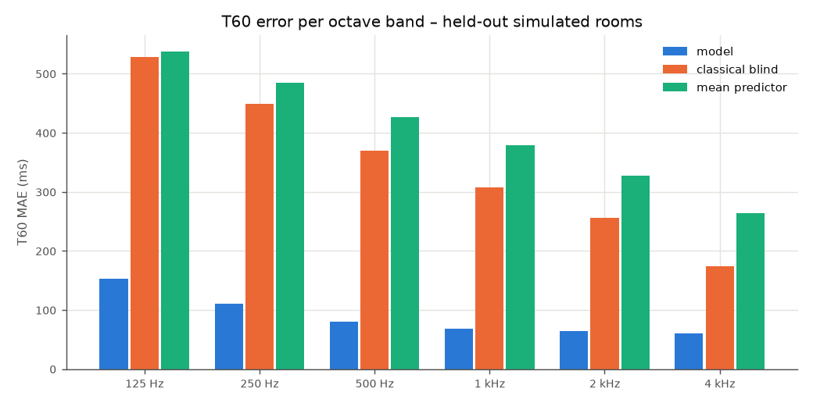
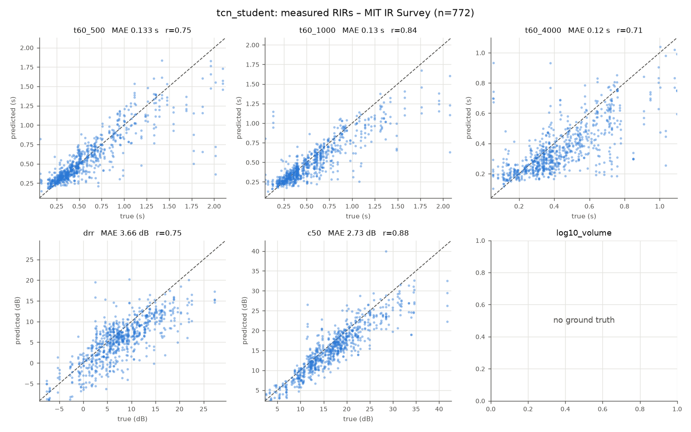

# Blind Room-Acoustics Estimator

Estimate how a room sounds - **reverberation time (T60) in six octave bands, direct-to-reverberant
ratio (DRR), clarity (C50) and room volume** - from ordinary audio (speech, music) captured by a
single microphone, with **no test signal**, in real time on a 120 KB int8 model.

This is the sensing half of room-adaptive audio: a speaker or headphone that knows the room's
decay per band, and how much of what the mic hears is direct vs. reflected, can adapt EQ,
dereverberation, beamforming or ANC to the space it is in.

```
 dry speech/music ──┐
                    ├─► ⊛ ─► + noise ─► log-mel ─► CRNN teacher ──distil──► TinyTCN student ─► int8 ONNX ─► real-time
 simulated RIRs ────┘   (8 000 RIRs / 4 000 rooms,            (0.9 M params)        (60 k params)     (C front-end,
 (pyroomacoustics,       labels from ISO 3382 analysis)                                                 numpy runtime)
  ISM + ray tracing)                                                    evaluated on unseen simulated rooms
                                                                        AND on 193 measured real-room RIRs
```

## Results

All numbers are on data the models never saw: **unseen simulated rooms + unseen speakers**
(800 renders), and **193 measured real-room RIRs** from the MIT IR Survey (outdoor spaces
excluded, 4 speech renders each = 772). T60 MAE is averaged over the six octave bands
(125 Hz-4 kHz). Full reports: [`reports/`](reports/).

### Held-out simulated rooms

| model | params | T60 MAE | DRR MAE | C50 MAE |
|---|---|---|---|---|
| mean predictor (floor) | – | 403 ms | 5.51 dB | 5.37 dB |
| classical blind DSP (free-decay regions, calibrated) | – | 348 ms | – | – |
| **CRNN teacher** | 880 k | **90 ms** | **1.90 dB** | **1.02 dB** |
| TinyTCN, trained from scratch | 60 k | 119 ms | 2.80 dB | 1.29 dB |
| **TinyTCN, distilled** | 60 k | **111 ms** | 2.71 dB | 1.24 dB |



### Measured real rooms (sim-to-real)

Trained only on simulation, never on a measured RIR:

| model | T60 MAE | DRR MAE | C50 MAE | T60 @ 1 kHz Pearson r |
|---|---|---|---|---|
| mean predictor | 304 ms | 11.4 dB | 10.1 dB | – |
| CRNN teacher | 140 ms | 2.75 dB | 2.06 dB | 0.89 |
| TinyTCN, from scratch | 171 ms | 4.20 dB | 3.00 dB | 0.84 |
| **TinyTCN, distilled** | **160 ms** | **3.66 dB** | **2.73 dB** | 0.84 |



### Deployment (int8, student)

| variant | size | latency (p50, 1 thread, M2) | T60 MAE | DRR MAE | C50 MAE |
|---|---|---|---|---|---|
| ONNX fp32 | 240 KB | 0.36 ms | 110 ms | 2.68 dB | 1.22 dB |
| **ONNX int8 (static, per-channel)** | **120 KB** | **0.26 ms** | 109 ms | 2.69 dB | 1.23 dB |

7.5 M MACs per 4 s window (teacher: 1.2 G, 160x more). Quantisation costs nothing measurable.
The C front-end adds 5.9 KB of code + tables.

### Takeaways

- **The learned model beats classical blind DSP by 3x** on T60 (90-111 ms vs 348 ms); the
  classical estimator is barely better than predicting the mean at low frequencies.
- **Distillation pays off most where it matters, on real rooms:** the distilled student beats the
  same architecture trained from scratch by 7 % on T60 and 13 % on DRR on measured RIRs, recovering
  part of the teacher's robustness at 1/15 of the parameters.
- **Sim-to-real gap is real but bounded:** T60 error grows ~45 % on measured rooms, mostly from
  under-estimating very reverberant spaces (T60 > 1.2 s, see scatter) and the 125 Hz band.
- **Volume is barely observable** from one mic (0.218 vs 0.240 log10 m³ for the mean predictor),
  as expected - a small hard room and a large damped one can share a T60.
- **Real-time demo** (speech through a measured classroom RIR): estimated mid-band T60
  0.41 / 0.35 s vs. ground truth 0.35 / 0.33 s; DRR 7.5 vs 8.1 dB.

The teacher was trained for 24 of its 25 scheduled epochs (the session ended during the last
epoch; one-cycle LR was ~0 by then). Both students ran the full 25 epochs.

## What's in the repo

| path | what |
|---|---|
| `roomest/acoustics.py` | ISO 3382-1 analysis: Schroeder EDC, T20/T30/T60 per octave band, EDT, DRR, C50; noise-floor handling for measured RIRs |
| `roomest/simulate.py` | Parallel RIR generation: random shoebox rooms, per-surface frequency-dependent absorption, scattering, air absorption, log-uniform T60 and source-mic distance targets; **room-level** train/val/test split |
| `roomest/data.py` | On-the-fly augmentation: dry source ⊛ RIR + coloured noise at random SNR + random level; speaker-level source split; synthetic impulsive/harmonic sources; measured-RIR loader |
| `roomest/features.py` | Log-mel front-end in torch (training) and numpy (runtime), verified identical |
| `roomest/models.py` | `CRNN` teacher (conv + BiGRU + attention pooling), `TinyTCN` student (dilated depthwise-separable 1-D convs - no recurrence, quantises cleanly); MAC counter; NaN-masked loss |
| `roomest/train.py` | Multi-task training, one-cycle LR, knowledge distillation from a teacher |
| `roomest/baselines.py` | Classical blind T60: free-decay-region detection + per-band calibration |
| `roomest/evaluate.py` | Metrics (MAE, RMSE, bias, Pearson r, % within perceptual JND), plots, sim and measured-RIR reports |
| `roomest/export.py` | ONNX export, static int8 quantisation (QDQ, per-channel), size/latency/accuracy report |
| `roomest/realtime.py` | Streaming estimator: ring buffer, activity gate, smoothing, live terminal dashboard, mic or file input |
| `roomest/measure.py` | Exponential-sine-sweep RIR measurement + analysis (ground truth for your own rooms) |
| `matlab/` | Same measurement and analysis in MATLAB (`measure_rir.m`, `analyze_rir.m`, self-test) |
| `embedded/` | C99 streaming log-mel front-end (static memory, sparse filterbank tables generated from Python), parity-tested against numpy |
| `scripts/` | `download_data.sh`, `run_pipeline.sh` (stage-selectable end-to-end pipeline) |
| `tests/` | 19 tests: physics against analytic answers, front-end parity (torch / numpy / C), sweep deconvolution, models |

## Quick start

```bash
uv venv --python 3.11 .venv && source .venv/bin/activate
uv pip install -r requirements.txt
pytest -q                                        # 19 tests

CONFIG=configs/smoke.yaml scripts/run_pipeline.sh   # every stage on a tiny config (minutes)
scripts/run_pipeline.sh                             # full run (M2 laptop: ~10 min sim, a few hours training)
```

Individual stages:

```bash
python -m roomest.simulate --config configs/default.yaml                     # data/sim/
python -m roomest.train    --name crnn_teacher                               # runs/crnn_teacher/
python -m roomest.train    --name tcn_student train.model=tcn train.teacher=runs/crnn_teacher/best.pt
python -m roomest.evaluate --ckpt runs/tcn_student/best.pt --real --baselines   # reports/tcn_student/
python -m roomest.export   --ckpt runs/tcn_student/best.pt                    # exported/tcn_student/
```

Any config value can be overridden from the CLI: `python -m roomest.train --name x train.epochs=40 data.snr_db=[0,30]`.

### Real-time demo

```bash
# live microphone
python -m roomest.realtime --model exported/tcn_student

# no mic: stream a speech file through a measured RIR - shows ground truth next to the estimate
python -m roomest.realtime --model exported/tcn_student \
    --wav data/raw/LibriSpeech/dev-clean/84/121123/84-121123-0000.flac \
    --rir data/raw/mit_ir/Audio/h001_Bedroom_65txts.wav
```

The estimator updates every 0.5 s from the last 4 s of audio, holds its estimate during silence
(nothing to observe), and smooths updates exponentially. Add `--log run.csv` to record a session.

### Measure your own rooms

```bash
python -m roomest.measure sweep --out data/measured/kitchen_pos1.wav --repeats 3
python -m roomest.measure analyze data/measured/kitchen_pos1.wav       # labels + decay-curve plot
python -m roomest.realtime --model exported/tcn_student --log kitchen.csv   # then talk / play music
```

Put measured RIRs in a folder and point `paths.real_rir_dir` at it to evaluate on them.

## Design decisions

**Labels come from the RIR, not from the simulator's parameters.** Sabine/Eyring predictions
disagree with the actual decay for non-diffuse rooms, and measured RIRs can only be labelled
by analysis. Running the *same* ISO 3382 code on simulated and measured RIRs keeps the targets
consistent across the sim-to-real boundary.

**Balanced label distribution by construction.** The simulator draws a target mid-band T60
log-uniformly (0.2-2 s) and scales random absorption spectra to hit it, and draws source-mic
distance log-uniformly (0.3-6 m). The first version sampled materials directly and produced a
median T60 near 1 s - far more reverberant than homes and offices.

**No leakage.** RIRs are split by *room* (two mic positions per room never straddle splits);
dry speech is split by *speaker*. Validation/test renders are seeded per index, so every
evaluation is reproducible.

**T60 is regressed in log space.** Perceived reverberance differences are relative (the JND is
~5 %), so a 100 ms error should matter more at 0.3 s than at 2 s.

**Gain-invariant but colour-preserving features.** One scalar (mean log energy) is subtracted
per clip. Per-frequency normalisation would also remove the spectral shape that carries per-band
decay information.

**Student without recurrence.** The deployable model is convolution-only (strided 2-D stem,
dilated depthwise-separable 1-D blocks, ~1.1 s receptive field) so it maps onto int8
CMSIS-NN / TFLite-Micro style kernels; the GRU teacher is only used for distillation.

**Masked multi-task loss.** Measured RIRs have no known volume, and any band whose decay
can't be fitted is NaN; those entries are masked out, not imputed.

## Limitations & next steps

- **Shoebox rooms only.** L-shaped rooms, coupled spaces and furniture are missing; adding
  `pra.Room.from_corners` geometries and scattering objects is the obvious next step.
- **Sim-to-real gap.** See the measured-RIR results above. Remedies: domain randomisation
  of microphone/loudspeaker responses, mixing a share of measured RIRs (ACE, BUT ReverbDB,
  OpenAIR) into training, and fine-tuning on recordings from the target device.
- **Single channel.** Bose devices have mic arrays; a multichannel model could use spatial
  coherence (diffuse field vs. direct path) for much better DRR and distance estimates.
- **Volume is weakly observable.** Blind volume estimation from one mic is ill-posed (a small
  hard room and a large damped one can share a T60); it is reported but down-weighted.
- **Embedded target.** The C front-end is in place; the next step is TFLite-Micro or CMSIS-NN
  inference on a Cortex-M7/M55 board, with a measured power and latency budget.

## Data & references

- LibriSpeech dev-clean (CC BY 4.0) - Panayotov et al., ICASSP 2015.
- MIT IR Survey - Traer & McDermott, *Statistics of natural reverberation*, PNAS 2016.
- pyroomacoustics - Scheibler et al., ICASSP 2018.
- ISO 3382-1:2009, *Measurement of room acoustic parameters*.
- Farina, *Simultaneous measurement of impulse response and distortion with a swept-sine technique*, AES 2000.
- Eaton et al., *Estimation of room acoustic parameters: the ACE challenge*, IEEE/ACM TASLP 2016.
- Gamper & Tashev, *Blind reverberation time estimation using a convolutional neural network*, IWAENC 2018.
