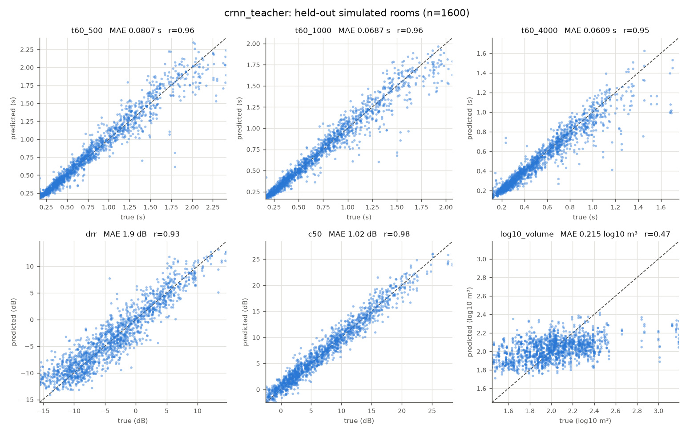
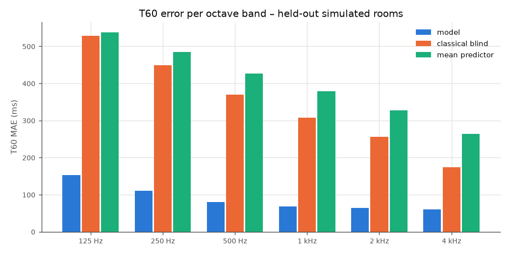
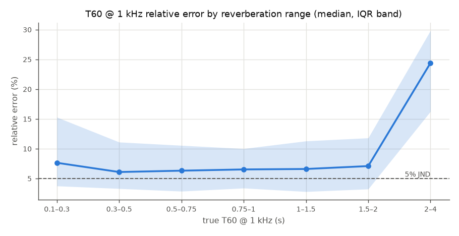
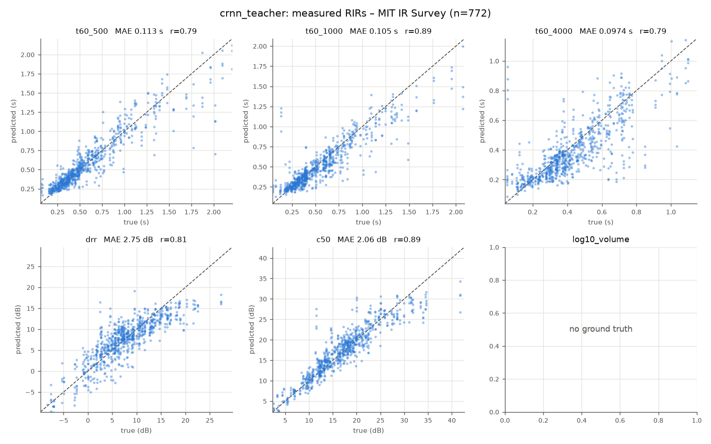
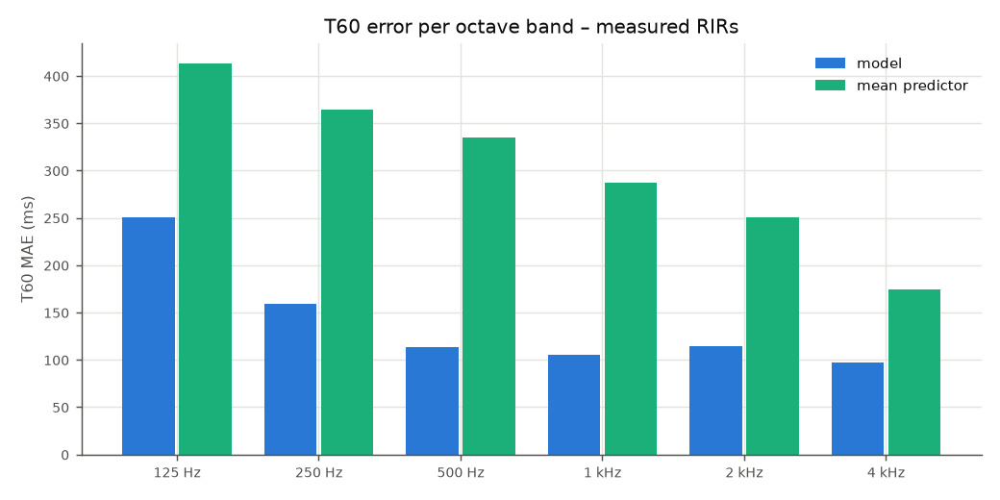

# Evaluation: `crnn_teacher` (crnn, epoch 24)

## Held-out simulated rooms (n=1600, unseen rooms and unseen speakers)

| target | unit | model MAE | classical blind MAE | mean predictor MAE | model r | model within JND |
|---|---|---|---|---|---|---|
| t60_125 | s | 0.153 | 0.528 | 0.538 | 0.94 | 21% |
| t60_250 | s | 0.110 | 0.449 | 0.485 | 0.96 | 29% |
| t60_500 | s | 0.081 | 0.370 | 0.427 | 0.96 | 36% |
| t60_1000 | s | 0.069 | 0.308 | 0.378 | 0.96 | 40% |
| t60_2000 | s | 0.065 | 0.256 | 0.328 | 0.96 | 39% |
| t60_4000 | s | 0.061 | 0.174 | 0.264 | 0.95 | 33% |
| drr | dB | 1.897 | – | 5.512 | 0.93 | 61% |
| c50 | dB | 1.016 | – | 5.368 | 0.98 | 59% |
| log10_volume | log10 m³ | 0.215 | – | 0.240 | 0.47 | 76% |

## Measured RIRs: sim-to-real (193 RIRs x 4 renders)

Volume is unknown for these rooms and is excluded. Outdoor spaces are excluded (regex `(?i)outside|outdoor|street|field|campground|parking|skatepark|bridge|backyard|balcony|forest|beach|woods`).

| target | unit | model MAE | mean predictor MAE | model r | model within JND |
|---|---|---|---|---|---|
| t60_125 | s | 0.251 | 0.413 | 0.63 | 10% |
| t60_250 | s | 0.159 | 0.364 | 0.76 | 18% |
| t60_500 | s | 0.113 | 0.335 | 0.79 | 21% |
| t60_1000 | s | 0.105 | 0.288 | 0.89 | 22% |
| t60_2000 | s | 0.115 | 0.251 | 0.82 | 20% |
| t60_4000 | s | 0.097 | 0.175 | 0.79 | 17% |
| drr | dB | 2.753 | 11.384 | 0.81 | 47% |
| c50 | dB | 2.060 | 10.112 | 0.89 | 39% |

