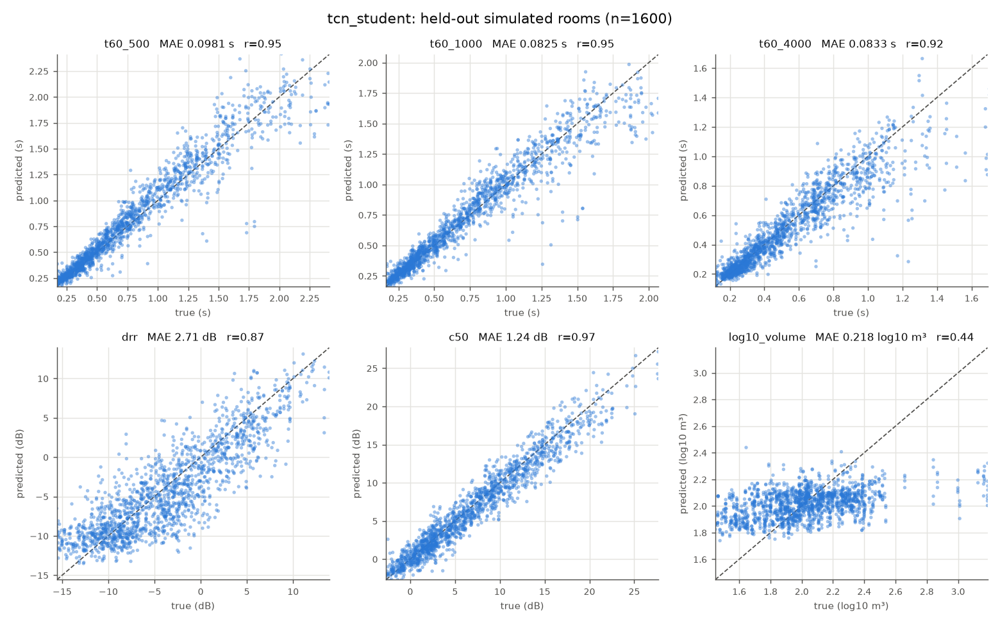
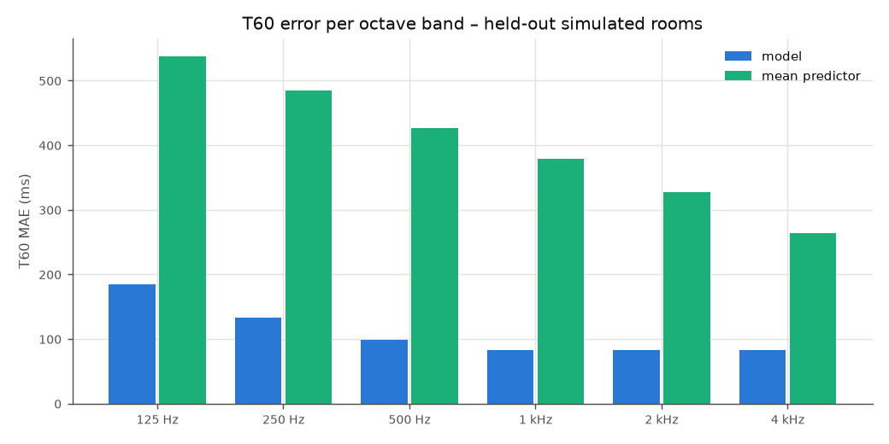
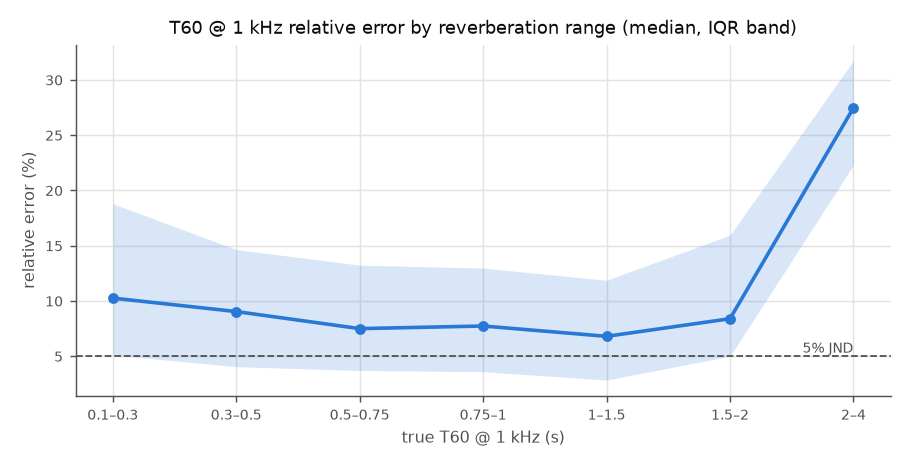
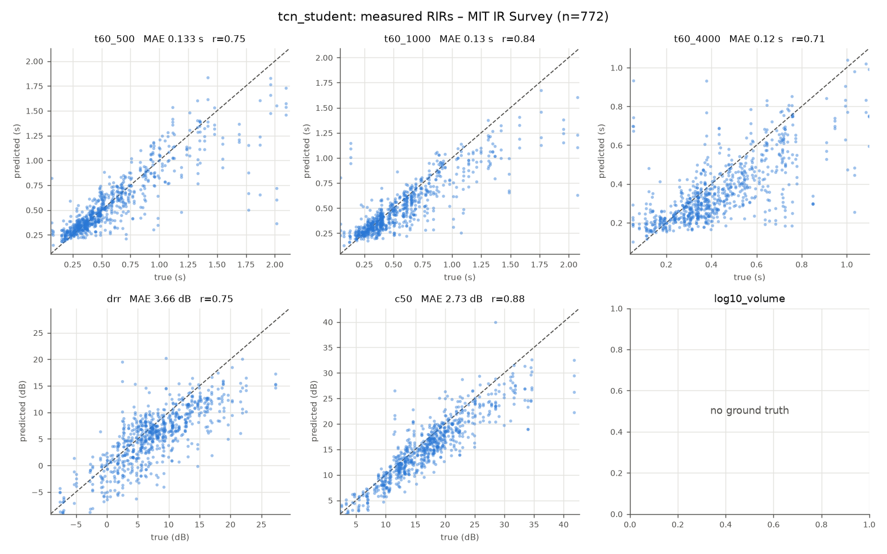
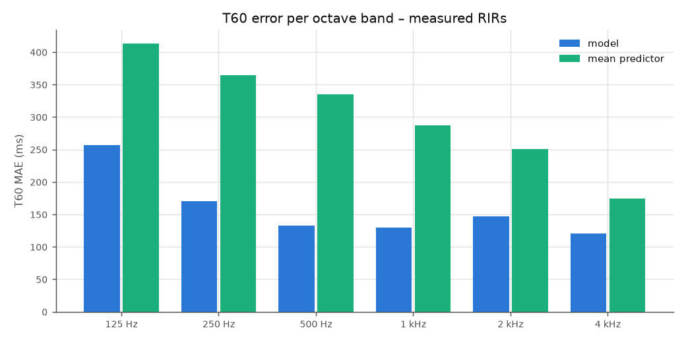

# Evaluation: `tcn_student` (tcn, epoch 21)

## Held-out simulated rooms (n=1600, unseen rooms and unseen speakers)

| target | unit | model MAE | mean predictor MAE | model r | model within JND |
|---|---|---|---|---|---|
| t60_125 | s | 0.184 | 0.538 | 0.93 | 17% |
| t60_250 | s | 0.133 | 0.485 | 0.95 | 22% |
| t60_500 | s | 0.098 | 0.427 | 0.95 | 26% |
| t60_1000 | s | 0.082 | 0.378 | 0.95 | 31% |
| t60_2000 | s | 0.084 | 0.328 | 0.94 | 30% |
| t60_4000 | s | 0.083 | 0.264 | 0.92 | 23% |
| drr | dB | 2.706 | 5.512 | 0.87 | 45% |
| c50 | dB | 1.244 | 5.368 | 0.97 | 52% |
| log10_volume | log10 m³ | 0.218 | 0.240 | 0.44 | 76% |

## Measured RIRs: sim-to-real (193 RIRs x 4 renders)

Volume is unknown for these rooms and is excluded. Outdoor spaces are excluded (regex `(?i)outside|outdoor|street|field|campground|parking|skatepark|bridge|backyard|balcony|forest|beach|woods`).

| target | unit | model MAE | mean predictor MAE | model r | model within JND |
|---|---|---|---|---|---|
| t60_125 | s | 0.257 | 0.413 | 0.64 | 10% |
| t60_250 | s | 0.170 | 0.364 | 0.74 | 16% |
| t60_500 | s | 0.133 | 0.335 | 0.75 | 20% |
| t60_1000 | s | 0.130 | 0.288 | 0.84 | 18% |
| t60_2000 | s | 0.147 | 0.251 | 0.76 | 13% |
| t60_4000 | s | 0.120 | 0.175 | 0.71 | 11% |
| drr | dB | 3.658 | 11.384 | 0.75 | 38% |
| c50 | dB | 2.726 | 10.112 | 0.88 | 26% |

